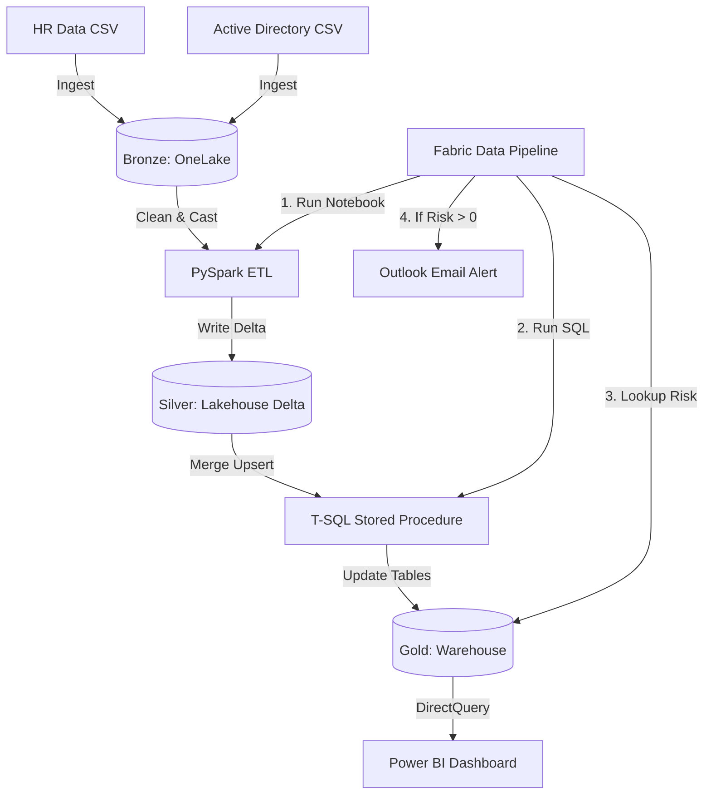
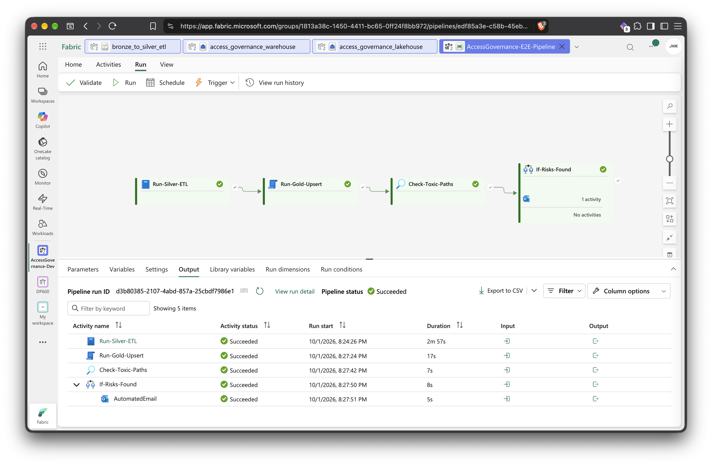
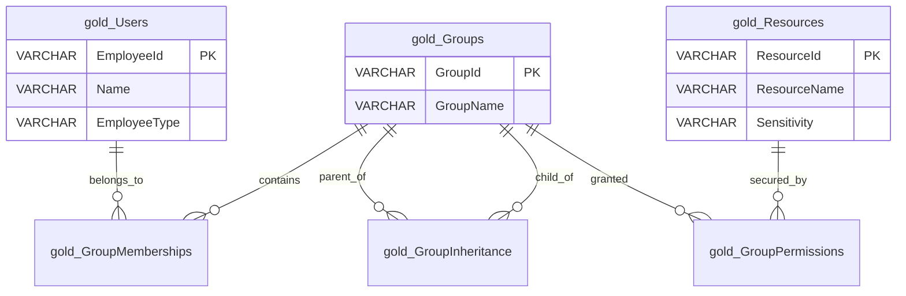
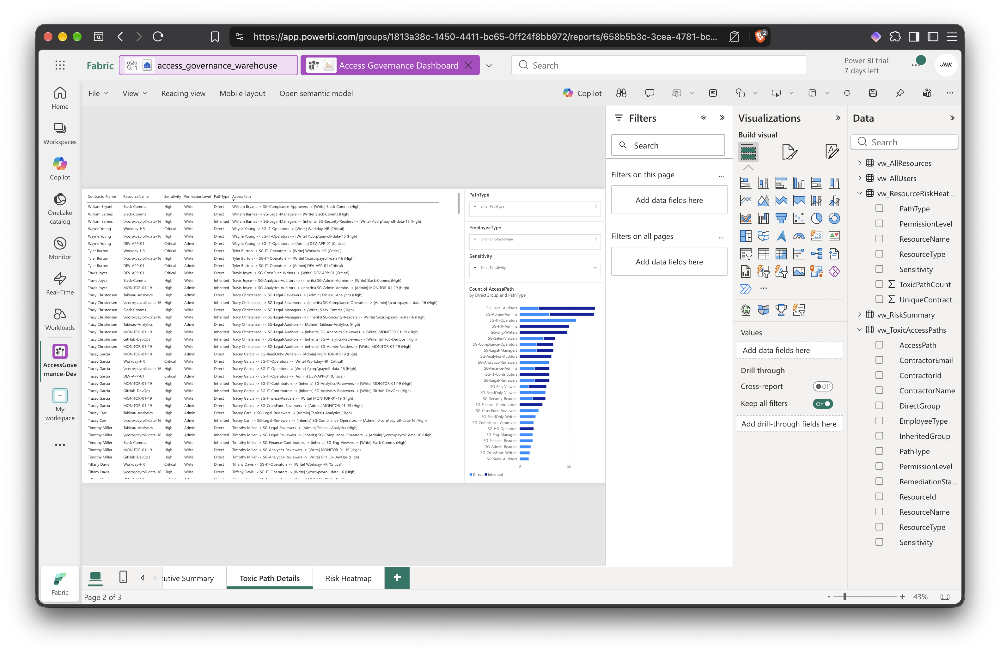

# Enterprise Access Governance Platform


An end to end Data Engineering platform built in Microsoft Fabric that identifies and reports "Toxic Access Paths" within a corporate network. By combining HR employee data with Active Directory group inheritance, this system automatically detects when external contractors gain unauthorized administrative access to critical resources through nested security groups.

This project demonstrates a production grade data architecture, incorporating:
* big data cleaning and schema enforcement using PySpark,
* advanced T-SQL Common Table Expressions (CTEs) for graph traversal,
* pipeline orchestration with automated Office 365 Outlook alerting,
* and a real time Power BI dashboard connected via DirectLake.


## Key Accomplishments

* **Accomplished** a Zero Trust security posture **as measured by** the automated identification of hidden vulnerability paths, **by** engineering a Medallion architecture entirely within Microsoft Fabric.
* **Accomplished** scalable hierarchical data processing **as measured by** the successful traversal of deeply nested Active Directory groups, **by** engineering complex recursive T-SQL Common Table Expressions to map graph like relationships.
* **Accomplished** automated incident response **as measured by** zero manual monitoring required by the SecOps team, **by** orchestrating a Fabric Data Pipeline that dynamically checks for risks and triggers an immediate Office 365 email alert.
* **Accomplished** an enterprise grade data warehouse **as measured by** zero downtime during data refreshes, **by** developing a SQL Stored Procedure that utilizes idempotent `MERGE` statements to upsert incoming records.
* **Accomplished** real time business intelligence **as measured by** instant loading of security metrics, **by** connecting a Power BI report directly to the Fabric Warehouse using DirectQuery and DirectLake mode.

## End-to-End Data Flow Summary

From ingestion to visualization, the platform executes the following automated sequence:
1. **Ingestion (Bronze):** Raw HR records and Active Directory inheritance logs are extracted and loaded into a Fabric OneLake folder.
2. **Transformation (Silver):** A PySpark cluster spins up to clean the raw data, enforce strict schemas, drop nulls, and write optimized Delta Parquet tables back to the Lakehouse.
3. **Warehousing (Gold):** A Fabric Data Pipeline triggers a T-SQL Stored Procedure that uses `MERGE` logic to upsert the new Delta tables into the Data Warehouse with zero downtime.
4. **Graph Analytics:** Recursive SQL Common Table Expressions (CTEs) mathematically map the deeply nested Active Directory groups to identify any external contractors who have inherited critical access.
5. **Automated Alerting:** An Azure Data Factory `Lookup` activity dynamically evaluates the risk count. If vulnerabilities are found, an `If Condition` triggers an immediate Office 365 Outlook email alert to the SecOps team.
6. **Visualization:** Security analysts click the alert email, opening a live Power BI dashboard connected via DirectLake to instantly investigate and revoke the toxic access paths.


## Production Grade Design: Live Data vs. Demonstration Data

To make this project publicly hostable and reproducible, a Python data generator creates synthetic CSV files to mock HR and Active Directory data. 

However, the architecture is built strictly for production. In a live enterprise environment, the Bronze layer connects directly to live REST APIs like Azure Entra ID and Workday. Furthermore, the Fabric Data Pipeline is designed to be triggered by an Azure Storage Event rather than a scheduled timer. This means the exact second a new Entra ID log is deposited into the data lake, the pipeline fires, the data is processed, and security gets an email if a new threat is detected.

## What This Project Does

The Access Governance system systematically:
* ingests HR personnel files and Active Directory security data into a Data Lakehouse,
* runs a PySpark notebook to cleanse the raw data, cast correct data types, and save optimized Delta Parquet tables,
* triggers a SQL Stored Procedure to perform incremental upserts into a Data Warehouse,
* executes graph logic to map every user to every resource they can access through group inheritance,
* flags any "External Contractor" or "Vendor" who has gained "Admin" or "Write" access to "High" or "Critical" sensitivity resources,
* automatically emails the security team if a new threat is found,
* and updates an interactive Power BI dashboard so administrators can immediately revoke the access.

## System Architecture & Orchestration




*The end to end Data Factory Pipeline orchestrating PySpark transformations, T-SQL upserts, and dynamic email alerting.*


## Tech Stack

### Core Data Platform
* **Microsoft Fabric:** Unified analytics platform hosting the Lakehouse, Warehouse, and Pipelines.
* **PySpark:** Distributed data processing used for the Silver layer transformations.
* **T-SQL:** Relational data modeling, Stored Procedures, and graph traversal.
* **Azure Data Factory:** Under the hood orchestration for Fabric Data Pipelines.
* **Power BI:** Business intelligence and data visualization.

### Languages
* **Python 3.12:** Data generation and PySpark scripts.
* **SQL:** DDL for schema creation, DML for upserts, and CTEs for analytics.

## Analytics Data Model



## Analytics & Business Intelligence

The Power BI dashboard provides a full command center for the security team. 


*Interactive reporting layer identifying critical vulnerabilities and specific nested group paths.*

1. **Executive Summary:** High level KPIs showing total toxic paths and total affected contractors.
2. **Toxic Paths Detail:** A granular table showing the exact hop by hop inheritance path causing the security breach.
3. **Risk Heatmap:** A visual matrix identifying which critical resources are most exposed.
4. **Group Analysis:** Visualizations highlighting which Active Directory groups are causing the most inherited risk.


## Project Highlights

This project demonstrates proficiency in:
* **Data Engineering Lifecycles:** Designing and implementing a Medallion Extract Load Transform (ELT) architecture within a modern Lakehouse environment.
* **Orchestration:** Using Azure Data Factory (Fabric Pipelines) to manage task dependencies, conditionally evaluate data states, and trigger dynamic alerts.
* **Batch Processing:** Leveraging PySpark for data wrangling, type casting, schema enforcement, and Delta Lake table management.
* **Database Design:** Engineering enterprise grade Data Warehouses with T-SQL, incorporating zero downtime upsert patterns via Stored Procedures.
* **Advanced Analytics:** Utilizing recursive Common Table Expressions (CTEs) to perform complex graph traversal operations over relational data.
* **Business Intelligence:** Building interactive, real time Power BI dashboards utilizing DirectQuery and DirectLake modes.

## Repository Structure

```text
.
├── assets/                                 # Screenshots and diagrams
├── data_generator/                         # Python framework for synthetic data
│   ├── config.py               
│   ├── generate_data.py        
│   └── requirements.txt        
├── docs/                                   # Step by step deployment guides
│   ├── 01_Data_Generation_Ingestion.md
│   ├── 02_Silver_Lakehouse_ETL.md
│   ├── 03_Gold_Warehouse_Analytics.md
│   ├── 04_Pipeline_Orchestration.md
│   └── 05_PowerBI_Dashboard.md
├── src/                                    # Source code
│   ├── gold_tsql/              
│   │   ├── 01_create_tables.sql
│   │   ├── 02_create_stored_proc.sql
│   │   └── 03_create_views.sql
│   └── silver_pyspark/         
│       └── bronze_to_silver_etl.ipynb
└── README.md                                  # Project documentation
```

## Quick Start

To reconstruct this project in your own Microsoft Fabric environment, please follow the documentation exactly in this order:

1. Follow [Data Generation & Ingestion](docs/01_Data_Generation_Ingestion.md) to generate the CSV files and upload them to OneLake.
2. Follow [Silver Lakehouse ETL](docs/02_Silver_Lakehouse_ETL.md) to process the raw data using PySpark.
3. Follow [Gold Warehouse Analytics](docs/03_Gold_Warehouse_Analytics.md) to build the relational tables, stored procedures, and graph logic views.
4. Follow [Pipeline Orchestration](docs/04_Pipeline_Orchestration.md) to automate the end to end flow and configure the Office 365 email alerts.
5. Follow [Power BI Dashboard](docs/05_PowerBI_Dashboard.md) to build the visual reporting layer.

<br><br>
Copyright © 2026 Janidu Kodithuwakku. All Rights Reserved.